  <picture>
    <source media="(prefers-color-scheme: dark)" srcset="assets/hero-dark.svg">
    <source media="(prefers-color-scheme: light)" srcset="assets/hero-light.svg">
    
  </picture>

<h3 align="center">Independent developer in Kendal, Indonesia.</h3>

  I build developer tools, Telegram bots, AI gateways, and web applications. 
  Mostly TypeScript, Node.js, and Python.

  Currently building <a href="https://dikaglorya.github.io/projects/dikaroute/"><strong>DikaRoute</strong></a>, an OpenAI-compatible gateway that routes requests across providers.

  
  
  
  

  <picture>
    <source media="(prefers-color-scheme: dark)" srcset="assets/divider-dark.svg">
    <source media="(prefers-color-scheme: light)" srcset="assets/divider-light.svg">
    
  </picture>

<h2 align="center">About</h2>

  <picture>
    <source media="(prefers-color-scheme: dark)" srcset="assets/about-3d-dark.svg">
    <source media="(prefers-color-scheme: light)" srcset="assets/about-3d-light.svg">
    
  </picture>

  One concrete problem at a time: an endpoint that stays up, a bot that removes a repetitive task, 
  or a page that loads before someone gives up on it.

<h2 align="center">Skills</h2>

  <picture>
    <source media="(prefers-color-scheme: dark)" srcset="assets/skills-3d-dark.svg">
    <source media="(prefers-color-scheme: light)" srcset="assets/skills-3d-light.svg">
    
  </picture>

  <picture>
    <source media="(prefers-color-scheme: dark)" srcset="assets/divider-dark.svg">
    <source media="(prefers-color-scheme: light)" srcset="assets/divider-light.svg">
    
  </picture>

<h2 align="center">GitHub stats</h2>

  <picture>
    <source media="(prefers-color-scheme: dark)" srcset="assets/stats-3d-dark.svg">
    <source media="(prefers-color-scheme: light)" srcset="assets/stats-3d-light.svg">
    
  </picture>

  <picture>
    <source media="(prefers-color-scheme: light)" srcset="https://github-readme-stats.vercel.app/api?username=dikaglorya&amp;show_icons=true&amp;theme=default&amp;hide_border=true">
    
  </picture>
   
  <picture>
    <source media="(prefers-color-scheme: light)" srcset="https://github-readme-stats.vercel.app/api/top-langs/?username=dikaglorya&amp;layout=compact&amp;theme=default&amp;hide_border=true">
    
  </picture>
   
  <picture>
    <source media="(prefers-color-scheme: light)" srcset="https://github-readme-streak-stats.herokuapp.com/?user=dikaglorya&amp;theme=default&amp;hide_border=true">
    
  </picture>

<h2 align="center">Contribution graph</h2>

  <picture>
    <source media="(prefers-color-scheme: dark)" srcset="https://raw.githubusercontent.com/dikaglorya/dikaglorya/output/github-contribution-grid-snake-dark.svg">
    <source media="(prefers-color-scheme: light)" srcset="https://raw.githubusercontent.com/dikaglorya/dikaglorya/output/github-contribution-grid-snake.svg">
    
  </picture>

  <picture>
    <source media="(prefers-color-scheme: dark)" srcset="assets/divider-dark.svg">
    <source media="(prefers-color-scheme: light)" srcset="assets/divider-light.svg">
    
  </picture>

<h2 align="center">Connect</h2>

  
  
  
  

  Telegram is usually the fastest way to reach me: <a href="https://t.me/dikaacode">@dikaacode</a>.

  <picture>
    <source media="(prefers-color-scheme: dark)" srcset="assets/footer-dark.svg">
    <source media="(prefers-color-scheme: light)" srcset="assets/footer-light.svg">
    
  </picture>

